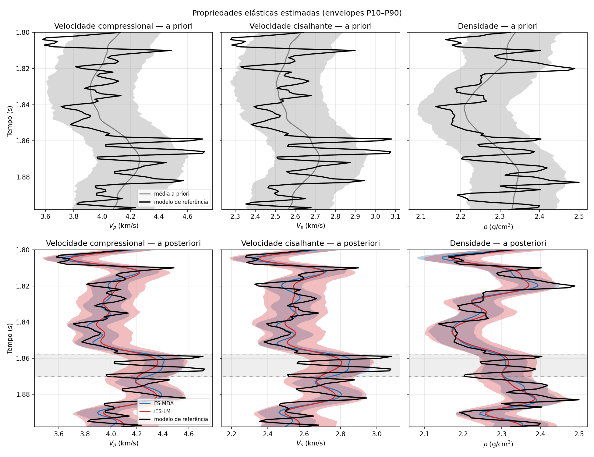
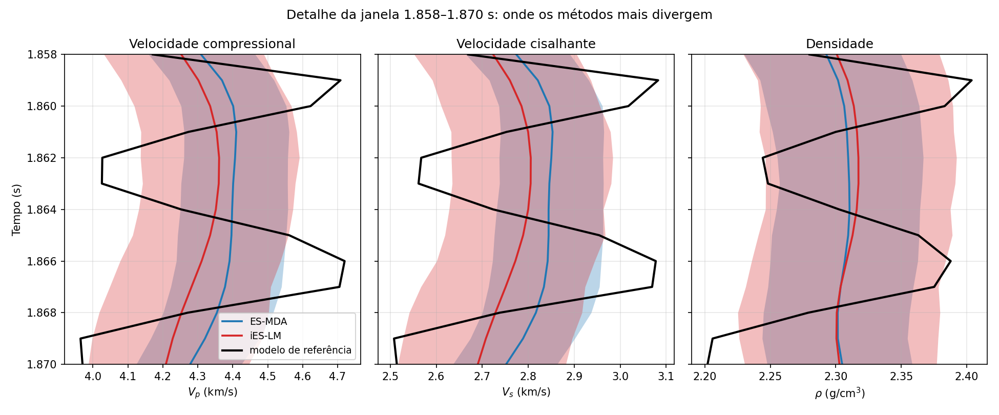
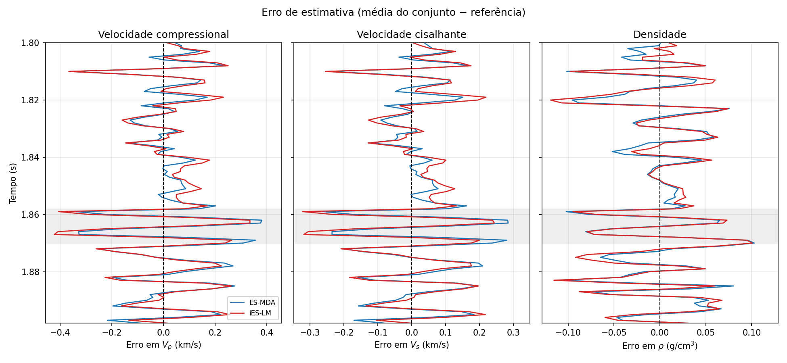
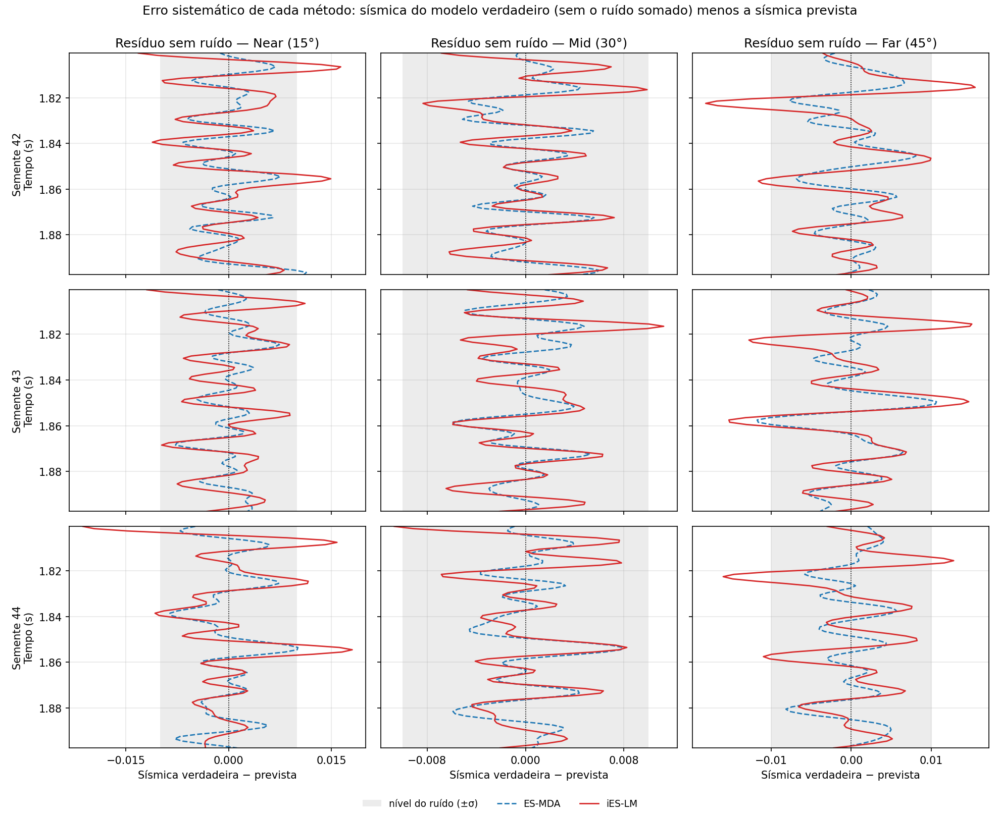

# iES-LM vs ES-MDA for 1D elastic seismic inversion

Python implementation of the **iterative ensemble smoother with
Levenberg-Marquardt** (iES-LM, called ES-LM in the original paper), applied to
the joint estimation of P-wave velocity, S-wave velocity and density from
three-angle seismic data, and compared against **ES-MDA**.

> Ma, X. and Bi, L. (2019). *A robust adaptive iterative ensemble smoother
> scheme for practical history matching applications.*
> Computational Geosciences 23:415–442. doi:10.1007/s10596-018-9786-9

The two methods differ in how they regularize the ensemble update step. ES-MDA
uses a **fixed** sequence of inflation factors chosen in advance; iES-LM adapts
its regularization parameter at every iteration through a trust-region rule
driven by the gain ratio. Comparing those two strategies under identical
conditions is the point of this repository.

Written as the practical part of an undergraduate thesis in Computer Science at
UFSC (Universidade Federal de Santa Catarina).

## Install

Requires Python 3.9+ and the [SeReMpy](https://github.com/dariograna/SeReMpy)
library, which supplies the forward-model primitives and the reference ES-MDA
implementation. SeReMpy is **not** modified or vendored here.

```bash
git clone https://github.com/lutomio/ieslm-seismic-inversion.git
cd ieslm-seismic-inversion
pip install -r requirements.txt
```

Then make SeReMpy available, either by placing it next to this project:

```bash
git clone https://github.com/dariograna/SeReMpy.git ../SeReMpy-main
```

or by pointing an environment variable at it:

```bash
export SEREMPY_PATH=/path/to/SeReMpy
```

## Run

```bash
python experimento_elastico.py          # one comparison: metrics table + figures
python bateria.py                       # 17-test battery from the SeReMpy driver inputs (T01 = main)
python sensibilidade.py --rapido        # reduced study, to check the code runs (~15 s)
python sensibilidade.py                 # full study, 1,000 runs (~5 min)
python sensibilidade.py --relatorio     # rebuild tables and figures from the CSV
python -m pytest tests/ -v              # 196 tests
```

Figures go to `figuras/`, each as PNG and as vector PDF (the PDFs are not
versioned; they are regenerated by the commands above). The sensitivity runs,
one row per run, go to `resultados/sensibilidade.csv`; the battery results go
to `resultados/bateria/`.

The versioned figures are the ones used in the thesis:

- `figuras/testes/T01_serempy/`: results of the main test (T01, first seed):
  estimated profiles, detail of the window where the methods differ most,
  estimation error and noise-free residual per angle. In the thesis they were
  generated without the test label that `bateria.py` writes in the corner.
- `figuras/tese/`: explanatory figures (seismic acquisition, forward model,
  non-uniqueness of the inverse problem, iteration flowchart of both methods
  and the experiment scheme). They use the code in this repository but are
  produced by thesis scripts that are not versioned here.

## Changing the inputs

Every input of the elastic experiment — ensemble size, noise level, wavelet,
incidence angles, prior settings, number of ES-MDA assimilations, iES-LM
parameters, reference model — lives in `config.py`. Change one without
editing any other file:

```python
from dataclasses import replace
import config, experimento_elastico

cfg = replace(config.PADRAO, snr=20.0, ne=100, alvo='6 camadas')
experimento_elastico.executa(cfg)
```

Invalid values are rejected with a message listing every problem. Each run
writes the configuration it used to `resultados/experimento_elastico_config.json`.

## Experimental setup

- **Forward model:** linearized AVO (Aki-Richards) convolved with a 45 Hz
  Ricker wavelet, at 15°, 30° and 45°, through SeReMpy's `SeismicModel`.
- **Observed data are generated, with noise.** The seismic traces shipped with
  SeReMpy were produced by this same operator from the well, without noise.
  Inverting them would be an *inverse crime*, so the experiment generates the
  data from the reference model and adds Gaussian noise at a controlled SNR
  (default 10); `C_D` matches that noise.
- **Reference model:** the SeReMpy well log, or a synthetic one from
  `referencia.py` (layered or smoothed).
- **Prior:** a smooth trend of the reference plus spatially correlated
  Gaussian perturbations. The trend and covariance come from the reference
  itself, as usual in synthetic studies. This makes the prior **optimistic**;
  the `vies_prior` axis measures what happens when the trend is wrong.
- **ES-MDA:** SeReMpy's `EnsembleSmootherMDA`, unmodified, with a decreasing
  sequence of inflation factors satisfying Σ 1/α_l = 1.
- **iES-LM:** γ⁰ = 1, stopping by the discrepancy principle with constant 4
  (Eq. 43), physical bounds by clipping.
- **Paired comparison:** in each repetition both methods see the same prior,
  noise and seed. Differences are tested with the Wilcoxon signed-rank test.

## Layout

| File | Contents |
|---|---|
| `ieslm.py` | **The algorithm** — Algorithm 2 of Ma & Bi (2019) |
| `config.py` | All experiment inputs in one place (`Configuracao`) |
| `experimento_elastico.py` | Main experiment: elastic inversion, metrics and figures |
| `sensibilidade.py` | Sensitivity study: 8 axes, 2 crossed grids, 1,000 paired runs |
| `bateria.py` | 17 tests from the SeReMpy seismic-inversion driver inputs, 20 paired seeds each |
| `forward_elastico.py` | Three-angle AVO forward model |
| `prior.py` | Prior ensemble (smooth trend + correlated perturbations) |
| `referencia.py` | Synthetic reference models (layered, smoothed) |
| `metricas.py` | RMSE, P10–P90 envelope, coverage, calibration error, KS test, α_l sequence |
| `dados.py` | Data loading and SeReMpy lookup |
| `experimento.py`, `forward.py` | Earlier acoustic-impedance case, kept as a simpler test bed |
| `tests/` | 196 tests |
| `data/` | Two data files redistributed from SeReMpy (MIT) |

Source and identifiers are in Portuguese, since this is a thesis project. The
mapping to the paper's notation is in the table below.

`ieslm.py` is **domain-agnostic**: it takes the forward model as a callable
`g`, so the same core runs both the paper's synthetic example and the seismic
problem. That is what makes it possible to validate the implementation against
a published result.

## Paper → code

| Symbol | Eq. | Location |
|---|---|---|
| C_MD, C_DD | 30, 31 | `covariancias()` |
| model update | 32 | `M + C_MD @ V` in `ieslm()` |
| per-member objective | 34 | `objetivo_por_membro()` (perturbed data) |
| gain ratio ρ_j | 37, 38 | `reducao_real / reducao_prevista` |
| average mismatch Ō | 39 | `desajuste_medio()` (unperturbed data) |
| γ, α update | 40, 41 | `fator_lm()` + median rule |
| discrepancy stop | 42, 43 | `desajuste_absoluto()`, `fator_ruido` |

## Validation

The anchor test reproduces the synthetic linear example of Section 5.1 of the
paper, whose maximum-likelihood solution is known analytically (4.76543):

| N_e | This implementation | Paper (Fig. 1) |
|---|---|---|
| 10 | 4.76640 | 4.76552 |
| 100 | 4.76599 | 4.76528 |
| 500 | 4.76385 | 4.76540 |

The elastic forward model reproduces the seismic traces shipped with SeReMpy
to within 1e-6, and every equation is unit-tested against hand-computable
values.

## Results

Twenty seeds per configuration, paired (seeds 42 to 61). "Significant" means
p < 0.05 in the paired Wilcoxon test.

### Main test: T01, SeReMpy driver inputs

This is the experiment presented in the thesis (`python bateria.py T01`). It
uses the same inputs as SeReMpy's `ESSeisInversionDriver.py`: N_e = 500, 45 Hz
Ricker wavelet, angles of 15°, 30° and 45°, C_D = 1e-4 I, and ES-MDA with
N_a = 4 and constant α = 4. The only difference is the observed data, generated
from the well log with noise of variance 1e-4 to avoid an inverse crime.
iES-LM uses γ⁰ = 1 and the Eq. 43 stopping rule with constant 4.

| Metric | Property | ES-MDA | iES-LM | Difference | p |
|---|---|---|---|---|---|
| RMSE | V_p (km/s) | 0.1534 | 0.1558 | +1.6% | 0.011 |
| | V_s (km/s) | 0.1173 | 0.1204 | +2.7% | 0.004 |
| | ρ (g/cm³) | 0.0465 | 0.0495 | +6.4% | < 0.001 |
| P10–P90 envelope width | V_p | 0.306 | 0.457 | +50% | < 0.001 |
| | V_s | 0.229 | 0.347 | +51% | < 0.001 |
| | ρ | 0.118 | 0.154 | +31% | < 0.001 |
| Coverage (ideal 0.8) | V_p | 0.72 | 0.86 | | < 0.001 |
| | V_s | 0.71 | 0.85 | | < 0.001 |
| | ρ | 0.79 | 0.87 | | < 0.001 |
| Calibration error, \|coverage − 0.8\| | V_p | 0.080 | 0.059 | | 0.043 |
| | V_s | 0.085 | 0.048 | | 0.001 |
| | ρ | 0.020 | 0.070 | | < 0.001 |
| Forward-model evaluations | | 5 | 2 | | |
| Time per inversion (s) | | 0.52 | 0.20 | | |

- **Accuracy:** ES-MDA has a slightly lower RMSE for all three properties. The
  difference is small but significant. Both reduce the error of the prior mean
  by similar amounts: 22% to 26% for the velocities and 34% to 38% for density.
- **Uncertainty:** the iES-LM envelope is wider. iES-LM is better calibrated
  for V_p and V_s, and ES-MDA is better calibrated for ρ. The calibration
  advantage does not hold for all three properties.
- **Data fit:** against the noise-free seismic of the reference profile, the
  residual RMS is 0.0035 for ES-MDA and 0.0054 for iES-LM, both below the noise
  standard deviation (0.01), with p < 0.001 at every angle. The final mean
  mismatch Ō is 0.50 for ES-MDA, the same level as the reference profile
  itself, and 1.18 for iES-LM.
- **Iterations:** iES-LM makes **a single update** in every seed. After the
  first iteration the mismatch is already below the Eq. 43 threshold (Ō < 2).
  The median gain ratio lies between 0.9985 and 0.9991, so the problem is
  nearly linear at this scale and the adaptive rule barely comes into play.
- **Cost:** 2 forward-model evaluations against 5. This is why iES-LM runs 2.6
  times faster: over 90% of both methods' time is spent in the forward model.
  Times were measured on an Apple M3 Pro with Python 3.13 and NumPy 2.4.
- **Without Eq. 43**, forcing a fixed number of iterations:

  | Iterations | Final Ō | Median ρ_j | RMSE of V_p | Coverage of V_p |
  |---|---|---|---|---|
  | 1 | 1.18 | 0.999 | 0.156 | 0.86 |
  | 2 | 0.47 | 0.997 | 0.162 | 0.63 |
  | 3 | 0.42 | 0.992 | 0.209 | 0.40 |
  | 4 | 0.41 | 0.986 | 0.297 | 0.23 |
  | 5 | 0.40 | 0.983 | 0.444 | 0.11 |

  From the second iteration on, the ensemble starts fitting the noise, and the
  gain ratio stays close to 1 without detecting it. With the default limit of
  10 iterations, the V_p RMSE reaches 2.08 and coverage drops to zero. In this
  scenario, the Eq. 43 stopping rule is what keeps the method on track.

First seed: estimated profiles (P10–P90 envelopes), detail of the window where
the means differ most, error of the mean against the reference, and noise-free
residual per angle:






Full results of the 17 battery tests are in
`resultados/bateria/bateria_resumo.txt` (68 statistical tests without
multiple-comparison correction: about 3.4 false positives expected).

### Sensitivity study, `config.PADRAO` scenario

This study varies one factor at a time from a different scenario (SNR 10,
N_e = 200, ES-MDA with decreasing α_l).

**At equal cost** (3 forward-model evaluations each: iES-LM against ES-MDA
with two assimilations; 20 of 20 seeds paired):

| Metric (V_p) | ES-MDA | iES-LM | p |
|---|---|---|---|
| RMSE | 0.1505 | 0.1507 | 0.70 |
| Coverage of the P10–P90 envelope (ideal 0.8) | 0.581 | 0.658 | < 0.001 |

At equal cost the two methods estimate equally well, and iES-LM represents
uncertainty in a better-calibrated way.

**Across the 29 distinct configurations of the study:**

| | iES-LM better | tie | ES-MDA better |
|---|---|---|---|
| RMSE of V_p | 1 | 21 | 7 |
| Calibration, \|coverage − 0.8\| | 18 | 8 | 3 |

- iES-LM is **not** a better point estimator. It loses in RMSE with little
  noise (SNR 20 and 50), with a 60° maximum angle and with N_e = 400, and
  wins only on the smoothed target.
- Its advantage is **calibration**, and it depends on its own tuning. The
  three configurations where ES-MDA is better calibrated are all iES-LM
  parameters away from the default: Eq. 43 constant 0.5 or 1, and γ⁰ = 0.25
  (the value the paper uses in its Example 2).
- On the synthetic targets both methods produce envelopes that are too wide
  (coverage above 0.8), and neither is better calibrated.
- A biased prior trend defeats both alike (−8%: RMSE ≈ 0.35, coverage ≈ 0.1).
  Band-limited seismic data cannot correct low-frequency errors.
- With 29 tests per metric and no multiple-comparison correction, about 1.5
  "significant" results per metric are expected by chance. Single borderline
  results (p between 0.01 and 0.05) should be read with that in mind.

These are synthetic experiments with an optimistic prior.

## Notes on the paper

**Eq. 38 as printed omits the 1/2 factor.** Eq. 34 defines the objective with a
1/2, and the paper states that `L(mⁱ) = O(mⁱ)`. Deriving `L` from Eq. 36 using
`Ḡ C_MD = C_DD` yields `L = (α²/2) vᵀ C_D v`. The factor is verifiable
independently: under a linear forward model the linearization is exact, so ρ
must equal 1. Measured: `1.00000000` with the factor, `1.103` without it.

**The Eq. 43 stopping rule is what prevents overfitting.** iES-LM minimizes a
maximum-likelihood objective with no prior term. In the default experiment,
with Eq. 43 switched off it fits the noise from the third iteration onward,
and the ensemble it returns (the one with the smallest mismatch) has a V_p
RMSE of 0.914, against 0.148 with the rule. Tightening the constant does not
help: 0.5 gives an RMSE of 0.74 over 20 seeds.

**The `min` in Eq. 41 prevents α from increasing.** In that same run without
Eq. 43, one step gives ρ ≈ −2158 for every member, and Eq. 40 asks for γ to
grow by a factor of about 10¹⁰, but α does not move. That step is caused by the
physical bounds: the collapsed ensemble takes a step 26 times its own spread,
15% of the values are clipped, and clipping breaks the linearization. Without
bounds the step does not diverge, and only the overfitting remains.

**In the default scenario ρ_j ≈ 1.** With the stopping rule, ρ_j stays
between 0.99 and 1.01, so the adaptive rule sits at its 1/3 floor and the
trust-region mechanism is barely exercised. It does leave the floor in harder
settings, for example with a single incidence angle (ρ ≈ 0.86).

## Corrections to earlier statements

The message of commit `101c8c9` contains two claims that later experiments
refuted:

- *"at 62% of the forward-model evaluations ... cheaper"*: that compared
  iES-LM with ES-MDA at four assimilations, an arbitrary choice. At equal cost
  the RMSE is the same (table above).
- *"with little noise iES-LM stops too early"*: tightening the Eq. 43 constant
  always made it worse. The disadvantage with little noise is still open;
  one hypothesis is the combination of an objective without a prior term and
  an α that cannot increase.

Earlier versions of this analysis also counted higher coverage as better
calibration. That holds only below 0.8: on the synthetic targets, where both
methods exceed 0.8, the apparent advantage of iES-LM becomes a tie.
Calibration is now measured as the distance to 0.8.

## Scope

This implements Algorithm 2 (Section 4) of the paper. The variants for unknown
diagonal covariance (Section 6, aES-LM) and for robust regression (Section 7,
rES-LM) are not implemented.

## License

MIT, see `LICENSE`. Third-party notices in `THIRD_PARTY.md`.
