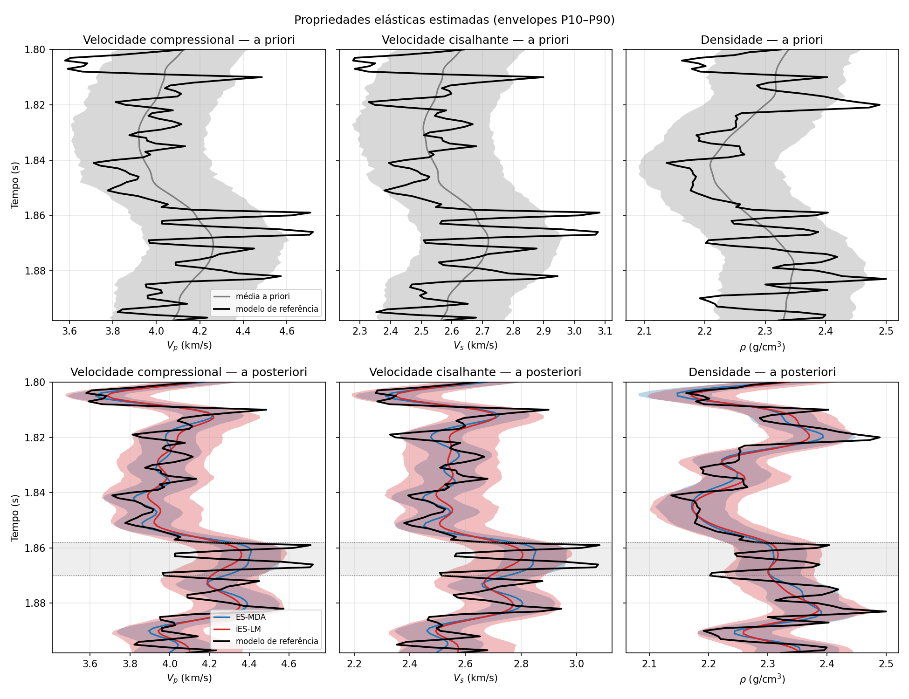
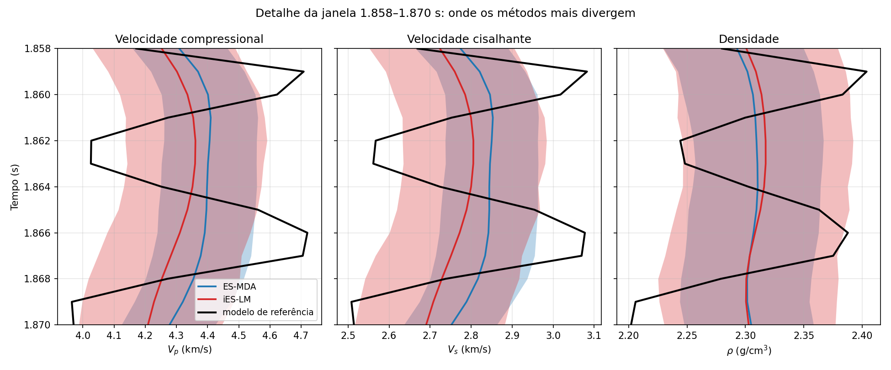
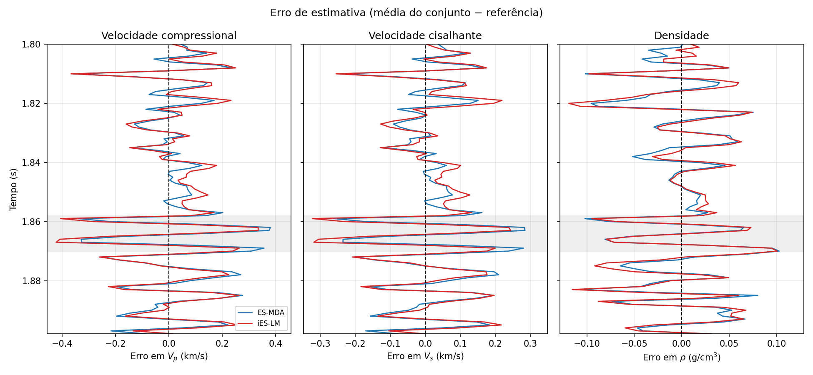
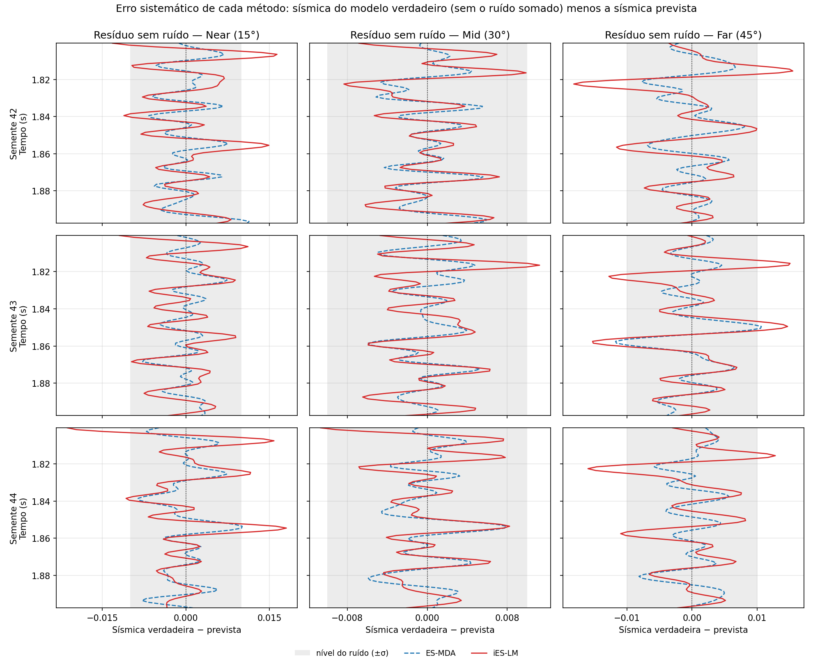

# iES-LM × ES-MDA na inversão sísmica elástica 1D

Código da parte prática do TCC de Lucas Tomio (UFSC — Ciências da Computação).
Implementa o **iES-LM** (Ma e Bi, 2019) e o compara com o **ES-MDA**
(Emerick e Reynolds, 2013) na estimativa conjunta da velocidade
compressional $V_p$, da velocidade cisalhante $V_s$ e da densidade $\rho$ a
partir de dados sísmicos de três ângulos.

O eixo da comparação é **como cada algoritmo regulariza o passo de atualização
do conjunto**: o ES-MDA usa fatores de inflação $\alpha_l$ fixados antes de
rodar; o iES-LM ajusta $\alpha^i$ a cada iteração por uma regra de região de
confiança baseada na razão de ganho.

## Instalação

Requer Python 3.9+ e a biblioteca [SeReMpy](https://github.com/dariograna/SeReMpy),
que fornece as primitivas do modelo direto e a implementação de referência do
ES-MDA. A SeReMpy **não** é modificada nem incorporada a este repositório.

```bash
git clone https://github.com/lutomio/ieslm-seismic-inversion.git
cd ieslm-seismic-inversion
pip install -r requirements.txt
```

Em seguida, torne a SeReMpy acessível, seja colocando-a ao lado deste projeto:

```bash
git clone https://github.com/dariograna/SeReMpy.git ../SeReMpy-main
```

seja apontando uma variável de ambiente para ela:

```bash
export SEREMPY_PATH=/caminho/para/SeReMpy
```

## Como rodar

```bash
python experimento_elastico.py          # uma comparação: tabela de métricas + figuras
python bateria.py                       # bateria de 17 testes a partir das entradas do driver da SeReMpy (T01 = principal)
python sensibilidade.py --rapido        # estudo reduzido, para conferir que o código roda (~15 s)
python sensibilidade.py                 # estudo completo, 1.000 execuções (~5 min)
python sensibilidade.py --relatorio     # refaz tabelas e figuras a partir do CSV
python -m pytest tests/ -v              # 196 testes
```

As figuras vão para `figuras/`, cada uma em PNG e em PDF vetorial (os PDFs
não são versionados; os comandos acima os regeneram). As execuções do estudo,
uma por linha, vão para `resultados/sensibilidade.csv`; os resultados da
bateria, para `resultados/bateria/`.

As figuras versionadas são as usadas no TCC:

- `figuras/testes/T01_serempy/`: resultados do teste principal (T01, primeira
  semente): perfis estimados, detalhe da janela em que os métodos mais
  divergem, erro de estimativa e resíduo sem ruído por ângulo. No TCC elas
  foram geradas sem o rótulo do teste que o `bateria.py` escreve no canto.
- `figuras/tese/`: figuras explicativas (aquisição sísmica, modelo direto,
  não unicidade do problema inverso, fluxograma da iteração dos dois métodos
  e esquema do experimento). Usam o código deste repositório, mas são geradas
  por scripts do texto que não estão versionados aqui.

## Como mudar as entradas

Todas as entradas do experimento elástico — tamanho do conjunto, nível de
ruído, wavelet, ângulos, *a priori*, número de assimilações do ES-MDA,
parâmetros do iES-LM, modelo de referência — ficam em `config.py`. Para mudar
uma delas, sem editar nenhum outro arquivo:

```python
from dataclasses import replace
import config, experimento_elastico

cfg = replace(config.PADRAO, snr=20.0, ne=100, alvo='6 camadas')
experimento_elastico.executa(cfg)
```

Valores inválidos são rejeitados com uma mensagem que lista todos os
problemas. Cada execução grava a configuração usada em
`resultados/experimento_elastico_config.json`.

## Montagem do experimento

- **Modelo direto:** AVO linearizado (Aki-Richards) convolvido com uma
  wavelet de Ricker de 45 Hz, em 15°, 30° e 45°, pelo `SeismicModel` da
  SeReMpy.
- **O dado observado é gerado, com ruído.** Os traços que acompanham a
  SeReMpy foram produzidos por este mesmo operador a partir do poço, sem
  ruído. Invertê-los seria *inverse crime*; por isso o experimento gera o
  dado a partir do modelo de referência e soma ruído gaussiano com SNR
  controlada (padrão 10). A $C_D$ corresponde a esse ruído.
- **Modelo de referência:** o perfil de poço da SeReMpy, ou um modelo
  sintético de `referencia.py` (em camadas ou suavizado).
- **A priori:** tendência suave da referência mais perturbações gaussianas
  correlacionadas. A tendência e a covariância vêm da própria referência, como
  é usual em estudo sintético. Isso torna o *a priori* **otimista**; o eixo
  `vies_prior` mede o que acontece quando a tendência está errada.
- **ES-MDA:** a `EnsembleSmootherMDA` da SeReMpy, sem modificação, com
  sequência decrescente de fatores satisfazendo $\sum 1/\alpha_l = 1$.
- **iES-LM:** $\gamma^0 = 1$, parada pelo princípio da discrepância com
  constante 4 (Eq. 43), limites físicos por truncamento.
- **Comparação pareada:** em cada repetição os dois métodos recebem o mesmo
  *a priori*, o mesmo ruído e a mesma semente. As diferenças são testadas com
  o teste de postos sinalizados de Wilcoxon.

## Organização

| Arquivo | Conteúdo |
|---|---|
| `ieslm.py` | **O algoritmo** — Algoritmo 2 de Ma e Bi (2019) |
| `config.py` | Todas as entradas do experimento num só lugar (`Configuracao`) |
| `experimento_elastico.py` | Experimento principal: inversão elástica, métricas e figuras |
| `sensibilidade.py` | Estudo de sensibilidade: 8 eixos, 2 grades cruzadas, 1.000 execuções pareadas |
| `bateria.py` | 17 testes a partir das entradas do driver de inversão sísmica da SeReMpy, 20 sementes pareadas cada |
| `forward_elastico.py` | Modelo direto AVO de três ângulos |
| `prior.py` | Conjunto *a priori* (tendência suave + perturbações correlacionadas) |
| `referencia.py` | Modelos de referência sintéticos (em camadas, suavizado) |
| `metricas.py` | RMSE, envelope P10–P90, cobertura, erro de calibração, teste KS, sequência de $\alpha_l$ |
| `dados.py` | Leitura dos dados e localização da SeReMpy |
| `experimento.py`, `forward.py` | Caso anterior, de impedância acústica, mantido como caso de teste mais simples |
| `tests/` | 196 testes |
| `data/` | Dois arquivos de dados redistribuídos da SeReMpy (MIT) |

O `ieslm.py` **não conhece sísmica**: recebe o modelo direto como uma função
`g`, de modo que o mesmo núcleo roda o exemplo sintético do artigo e o
problema sísmico. É isso que permite validar a implementação contra um
resultado publicado.

## Do artigo ao código

| Símbolo | Eq. | Onde |
|---|---|---|
| $C_{MD}$, $C_{DD}$ | 30, 31 | `covariancias()` |
| atualização do modelo | 32 | `M + C_MD @ V` em `ieslm()` |
| objetivo por membro | 34 | `objetivo_por_membro()` (dado perturbado) |
| razão de ganho $\rho_j$ | 37, 38 | `reducao_real / reducao_prevista` |
| desajuste médio $\bar O$ | 39 | `desajuste_medio()` (dado sem perturbação) |
| atualização de $\gamma$ e $\alpha$ | 40, 41 | `fator_lm()` + regra da mediana |
| parada por discrepância | 42, 43 | `desajuste_absoluto()`, `fator_ruido` |

## Validação

O teste-âncora, `test_mabi_exemplo1.py`, reproduz o exemplo linear da Seção
5.1 do artigo, cuja solução de máxima verossimilhança é conhecida
analiticamente ($4{,}76543$):

| $N_e$ | Esta implementação | Artigo (Fig. 1) |
|---|---|---|
| 10 | 4,76640 | 4,76552 |
| 100 | 4,76599 | 4,76528 |
| 500 | 4,76385 | 4,76540 |

O modelo direto elástico reproduz os traços que acompanham a SeReMpy com erro
abaixo de $10^{-6}$, e cada equação é testada isoladamente contra valores
calculáveis à mão.

## Resultados

Vinte sementes por configuração, pareadas (sementes 42 a 61). "Significativo"
quer dizer p < 0,05 no teste de Wilcoxon pareado.

### Teste principal: T01, entradas do driver da SeReMpy

É o experimento apresentado no TCC (`python bateria.py T01`). Usa as mesmas
entradas do `ESSeisInversionDriver.py` da SeReMpy: $N_e = 500$, wavelet de
Ricker de 45 Hz, ângulos de 15°, 30° e 45°, $C_D = 10^{-4} I$ e ES-MDA com
$N_a = 4$ e $\alpha = 4$ constante. A única diferença é o dado observado, gerado
do poço com ruído de variância $10^{-4}$, para evitar o *inverse crime*. O
iES-LM usa $\gamma^0 = 1$ e a parada da Eq. 43 com constante 4.

| Métrica | Propriedade | ES-MDA | iES-LM | Diferença | p |
|---|---|---|---|---|---|
| RMSE | $V_p$ (km/s) | 0,1534 | 0,1558 | +1,6% | 0,011 |
| | $V_s$ (km/s) | 0,1173 | 0,1204 | +2,7% | 0,004 |
| | $\rho$ (g/cm³) | 0,0465 | 0,0495 | +6,4% | < 0,001 |
| Largura do envelope P10–P90 | $V_p$ | 0,306 | 0,457 | +50% | < 0,001 |
| | $V_s$ | 0,229 | 0,347 | +51% | < 0,001 |
| | $\rho$ | 0,118 | 0,154 | +31% | < 0,001 |
| Cobertura (ideal 0,8) | $V_p$ | 0,72 | 0,86 | | < 0,001 |
| | $V_s$ | 0,71 | 0,85 | | < 0,001 |
| | $\rho$ | 0,79 | 0,87 | | < 0,001 |
| Erro de calibração, $\lvert\text{cobertura} - 0{,}8\rvert$ | $V_p$ | 0,080 | 0,059 | | 0,043 |
| | $V_s$ | 0,085 | 0,048 | | 0,001 |
| | $\rho$ | 0,020 | 0,070 | | < 0,001 |
| Avaliações do modelo direto | | 5 | 2 | | |
| Tempo por inversão (s) | | 0,52 | 0,20 | | |

- **Precisão:** o ES-MDA tem RMSE ligeiramente menor nas três propriedades. A
  diferença é pequena, mas significativa. Os dois reduzem o erro da média
  *a priori* em proporções parecidas: de 22% a 26% nas velocidades e de 34% a
  38% na densidade.
- **Incerteza:** o envelope do iES-LM é mais largo. Ele é mais calibrado em
  $V_p$ e $V_s$, e o ES-MDA é mais calibrado em $\rho$. A vantagem de
  calibração não vale para as três propriedades.
- **Ajuste aos dados:** comparado com a sísmica do perfil de referência sem
  ruído, o RMS do resíduo é 0,0035 no ES-MDA e 0,0054 no iES-LM, ambos abaixo
  do desvio padrão do ruído (0,01), com p < 0,001 em cada ângulo. O
  desajuste médio final $\bar{O}$ é 0,50 no ES-MDA, o mesmo nível do próprio
  perfil de referência, e 1,18 no iES-LM.
- **Iterações:** o iES-LM faz **uma só atualização** em todas as sementes. Na
  primeira iteração, o desajuste fica abaixo do limiar da Eq. 43 ($\bar{O} < 2$).
  A mediana da razão de ganho fica entre 0,9985 e 0,9991, ou seja, o problema
  é quase linear nessa escala e a regra adaptativa quase não atua.
- **Custo:** 2 avaliações do modelo direto contra 5. Por isso o iES-LM roda
  2,6 vezes mais rápido: mais de 90% do tempo dos dois métodos está no modelo
  direto. Os tempos foram medidos em um Apple M3 Pro com Python 3.13 e
  NumPy 2.4.
- **Sem a Eq. 43**, forçando um número fixo de iterações:

  | Iterações | $\bar{O}$ final | Mediana de $\rho_j$ | RMSE de $V_p$ | Cobertura de $V_p$ |
  |---|---|---|---|---|
  | 1 | 1,18 | 0,999 | 0,156 | 0,86 |
  | 2 | 0,47 | 0,997 | 0,162 | 0,63 |
  | 3 | 0,42 | 0,992 | 0,209 | 0,40 |
  | 4 | 0,41 | 0,986 | 0,297 | 0,23 |
  | 5 | 0,40 | 0,983 | 0,444 | 0,11 |

  A partir da segunda iteração, o conjunto passa a ajustar o ruído, e a razão
  de ganho continua perto de 1, sem detectar o problema. Com o limite padrão de
  10 iterações, o RMSE de $V_p$ chega a 2,08 e a cobertura a zero. Neste
  cenário, é a parada pela Eq. 43 que sustenta o método.

Primeira semente: perfis estimados (envelopes P10–P90), detalhe da janela em
que as médias mais divergem, erro da média em relação à referência e resíduo
sem ruído por ângulo:






O resultado completo dos 17 testes da bateria está em
`resultados/bateria/bateria_resumo.txt` (68 testes estatísticos sem correção
para comparações múltiplas: cerca de 3,4 falsos positivos esperados).

### Estudo de sensibilidade, cenário `config.PADRAO`

O estudo varia um fator por vez a partir de outro cenário (SNR 10, $N_e = 200$,
ES-MDA com $\alpha_l$ decrescente).

**No mesmo custo** (3 avaliações do modelo direto para cada um: iES-LM contra
ES-MDA com duas assimilações; 20 de 20 sementes pareadas):

| Métrica ($V_p$) | ES-MDA | iES-LM | p |
|---|---|---|---|
| RMSE | 0,1505 | 0,1507 | 0,70 |
| Cobertura do envelope P10–P90 (ideal 0,8) | 0,581 | 0,658 | < 0,001 |

No mesmo custo, os dois métodos estimam igualmente bem, e o iES-LM representa
a incerteza de forma mais calibrada.

**Nas 29 configurações distintas do estudo:**

| | iES-LM melhor | empate | ES-MDA melhor |
|---|---|---|---|
| RMSE de $V_p$ | 1 | 21 | 7 |
| Calibração, $\lvert\text{cobertura} - 0{,}8\rvert$ | 18 | 8 | 3 |

- O iES-LM **não** é um estimador pontual melhor. Perde em RMSE com pouco
  ruído (SNR 20 e 50), com ângulo máximo de 60° e com $N_e = 400$, e vence só
  no alvo suavizado.
- A vantagem dele é a **calibração**, e ela depende da sua própria
  sintonia. As três configurações em que o ES-MDA é mais calibrado são todas
  parâmetros do iES-LM fora do padrão: constante da Eq. 43 em 0,5 ou 1, e
  $\gamma^0 = 0{,}25$ (o valor que o artigo usa no seu Exemplo 2).
- Nos alvos sintéticos os dois métodos produzem envelopes largos demais
  (cobertura acima de 0,8), e nenhum é mais calibrado que o outro.
- Uma tendência *a priori* com viés derruba os dois igualmente (−8%: RMSE
  ≈ 0,35 e cobertura ≈ 0,1). A sísmica limitada em banda não corrige erro de
  baixa frequência.
- Com 29 testes por métrica e sem correção para comparações múltiplas,
  espera-se cerca de 1,5 resultado "significativo" por acaso em cada métrica.
  Resultados isolados no limite (p entre 0,01 e 0,05) devem ser lidos com
  isso em mente.

São experimentos sintéticos, com *a priori* otimista.

## Observações sobre o artigo

**1. A Eq. 38 impressa omite o fator 1/2.** A Eq. 34 define o objetivo com
$\tfrac12$, e o artigo afirma que $L^i_j(m^i_j) = O^i_j(m^i_j)$. Derivando $L$
a partir da Eq. 36, com $\bar G\,C_{MD} = C_{DD}$, chega-se a

$$L^i_j(m^{i+1}_j) = \frac{(\alpha^i)^2}{2}\, v^\top C_D\, v, \qquad v = (C_{DD} + \alpha^i C_D)^{-1} r .$$

A verificação é independente: com modelo linear a linearização é exata, então
$\rho_j$ tem de valer 1. Medido: $1{,}00000000$ com o fator, $1{,}103$ sem ele.

**2. A parada da Eq. 43 é o que evita o sobreajuste.** O iES-LM minimiza um
objetivo de máxima verossimilhança, sem termo de *a priori*. No experimento
padrão, com a Eq. 43 desligada, ele passa a ajustar o ruído a partir da
terceira iteração, e o conjunto que devolve (o de menor desajuste) tem RMSE de
$V_p$ 0,914, contra 0,148 com a parada. Apertar a constante não ajuda: com
0,5, o RMSE médio em 20 sementes é 0,74.

**3. O `min` da Eq. 41 impede $\alpha$ de crescer.** Na mesma execução sem a
Eq. 43, um passo dá $\rho \approx -2158$ em todos os membros, e a Eq. 40 pede
para multiplicar $\gamma$ por cerca de $10^{10}$, mas $\alpha$ não se move. Esse
passo é causado pelos limites físicos: o conjunto colapsado dá um passo 26
vezes maior que o próprio espalhamento, 15% dos valores são truncados, e o
truncamento quebra a linearização. Sem limites, o passo não diverge, e resta
só o sobreajuste.

**4. No cenário padrão, $\rho_j \approx 1$.** Com a parada, $\rho_j$ fica entre
0,99 e 1,01, então a regra adaptativa opera no piso de 1/3 e o mecanismo de
região de confiança quase não é exercitado. Ele sai do piso em cenários mais
difíceis, por exemplo com um só ângulo ($\rho \approx 0{,}86$).

## Correções de afirmações anteriores

A mensagem do commit `101c8c9` contém duas afirmações que experimentos
posteriores refutaram:

- *"a 62% das avaliações do modelo direto [...] mais barato"*: comparava o
  iES-LM com o ES-MDA de quatro assimilações, uma escolha arbitrária. No
  mesmo custo, o RMSE é igual (tabela acima).
- *"com pouco ruído o iES-LM para cedo demais"*: apertar a constante da
  Eq. 43 sempre piorou. A desvantagem com pouco ruído segue em aberto; uma
  hipótese é a combinação de um objetivo sem termo de *a priori* com um
  $\alpha$ que não pode crescer.

Versões anteriores desta análise também contavam cobertura maior como
calibração melhor. Isso só vale abaixo de 0,8: nos alvos sintéticos, em que os
dois métodos passam de 0,8, a vantagem aparente do iES-LM vira empate. A
calibração agora é medida pela distância a 0,8.

## Escopo

Implementa o Algoritmo 2 (Seção 4) do artigo. As variantes para covariância
diagonal desconhecida (Seção 6, aES-LM) e para regressão robusta (Seção 7,
rES-LM) não foram implementadas.

## Licença

MIT, ver `LICENSE`. Avisos de terceiros em `THIRD_PARTY.md`.

## Referências

- Ma, X. e Bi, L. (2019). *A robust adaptive iterative ensemble smoother
  scheme for practical history matching applications*.
  Computational Geosciences 23:415–442. — **artigo central**
- Emerick, A. e Reynolds, A. (2013). *Ensemble smoother with multiple data
  assimilation*. Computers & Geosciences 55:3–15.
- Grana, D., Mukerji, T. e Doyen, P. (2021). *Seismic Reservoir Modeling*.
  Wiley. — biblioteca SeReMpy e modelo direto.
